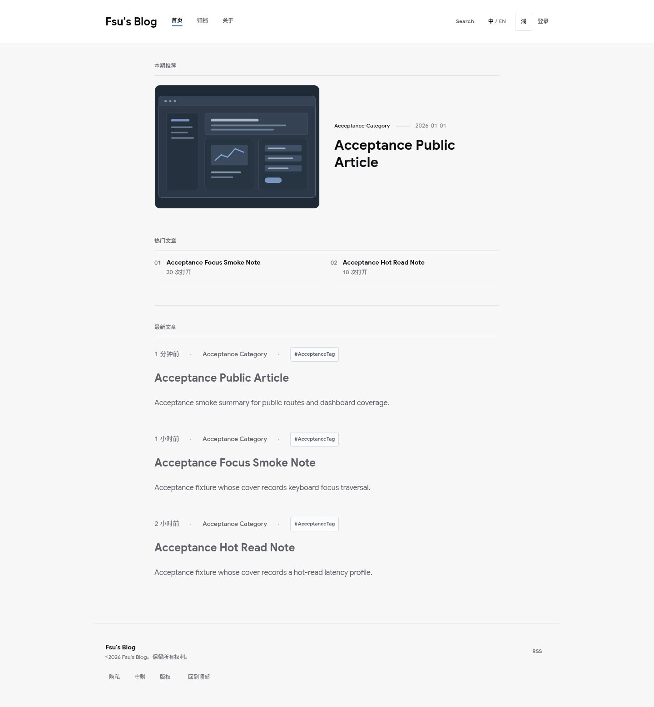

# Fsu's Blog

一个面向真实部署、以二进制公开读取链路和可验证运行时契约为核心的个人内容系统。

> **v1.1.0-public-preview** — FsusBlog 当前处于公开预览阶段，可用于开发、自托管实验和代码审查，但在 v1.2.0 前 API、部署契约、数据模型、后台工作流和性能 profile 仍可能发生破坏性变更。不应将 v1.1.0-public-preview 视为稳定生产版。

| Public preview entry | Link |
| ---------------------- | ------ |
| Architecture overview | [docs/architecture/overview.md](docs/architecture/overview.md) |
| Roadmap | [ROADMAP.md](ROADMAP.md) |
| API stability | [docs/api/stability.md](docs/api/stability.md) |
| Known limitations | [docs/known-limitations.md](docs/known-limitations.md) |
| Security policy | [SECURITY.md](SECURITY.md) |
| Security domain ownership | [docs/security/security-domain-layout.md](docs/security/security-domain-layout.md) |
| Support routing | [SUPPORT.md](SUPPORT.md) |
| Contributing guide | [CONTRIBUTING.md](CONTRIBUTING.md) |
| Repository governance | [docs/repository-governance.md](docs/repository-governance.md) |
| Code of conduct | [CODE_OF_CONDUCT.md](CODE_OF_CONDUCT.md) |
| License | [Apache-2.0](LICENSE) |
| Open source readiness | [docs/open-source-readiness.md](docs/open-source-readiness.md) |

## 功能特性

| 功能 | 说明 |
| ------ | ------ |
| 公开内容页 | 首页、归档、分类、标签、文章详情，AOT 预渲染 + SPA hydration 双路保障首屏 |
| Binary 传输 | AEDS v2 二进制帧协议，C++23 Wasm / TypeScript 双解码，hot-path 池化写入且不构造第二份完整 frame，不回退旧文本 API |
| 本地搜索 | Service Worker 缓存静态索引 + 浏览器端 Wasm 排序，无服务端在线检索 |
| 认证与授权 | PoW 前置 + 注册/登录 + AEDS auth frame + HttpOnly Cookie session |
| 通行密钥 (Passkey) | WebAuthn / FIDO2 Discoverable Credential，无密码登录，最多 5 枚/用户 |
| 多因素认证 (MFA) | TOTP RFC 6238，独立恢复码，管理员重置 |
| 多会话管理 | 查看活跃会话，吊销单个或全部其他会话 |
| 实时通知 | WebSocket binary notification stream（`/api/notifications/stream`，子协议 `fsus-aeds.v2`） |
| 站内消息 | 用户收发对话，管理员广播，对话状态管理 |
| 管理后台 | 用户管理、内容审核、站点统计（Binary 读链） |
| 多分层测试 | `tests/matrix.yml` 驱动的 DAG，覆盖 fast / coverage-gate / runtime / visual / security / resilience / load / backend-qps / production / release-final |

## 项目定位

FsusBlog 以 `SEO 首访速度 + 运行时一致性 + 工程可维护性` 为核心约束：

- **公开页优先**：首页、归档、分类、标签、文章详情优先保障首屏和可索引性。
- **统一契约**：同一业务对象在 AEDS Binary、Public AOT 与必要 JSON 运维/证明端点中保持同一语义。
- **单体优先**：减少跨服务跳转，把复杂度压在工程内部而不是部署拓扑上。
- **安全前置**：PoW、JWT、多会话、MFA、Passkey、风控、注销、缓存治理都按基础设施能力建设。
- **前端性能优先**：浏览器本地搜索、Service Worker 边缘缓存、Wasm 渲染与解码进入正式主链。

## Screenshots



更多 sanitized public-preview screenshots 见 [docs/assets/screenshots/](docs/assets/screenshots/)。这些截图使用 fictional demo content，不包含真实生产域名、邮箱、IP、日志、token 或私有标识。当前限制见 [docs/known-limitations.md](docs/known-limitations.md)。

## 架构概览

### 技术栈

**后端**

| 技术 | 版本 | 用途 |
| ------ | ------ | ------ |
| .NET SDK / C# | 10 / 14 | 运行时与语言版本 |
| ASP.NET Core Kestrel | 10 | HTTP 服务器 |
| SqlSugar | 5.1.4.214 | PostgreSQL ORM，CodeFirst |
| Redis | — | L2 缓存 + WebSocket notification backlog |
| Fido2 | 4.0.1 | WebAuthn / Passkey |
| BCrypt.Net-Next | 4.1.0 | 密码哈希 |
| Serilog | 4.3.1 | 结构化日志，异步滚动文件 |
| IP2Location | — | 地理定位 |

**前端**

| 技术 | 版本 | 用途 |
| ------ | ------ | ------ |
| Vue | 3.5.x | 渐进式框架 |
| Vite | 8.x | 构建工具，HMR |
| TypeScript | 6.x | 静态类型 |
| Pinia | 3.0.x | 状态管理 + 持久化 |
| Vue Router | 4.6.x | 客户端路由 |
| Tailwind CSS | 4.2.x | 原子化样式 |
| @simplewebauthn/browser | 13.3.0 | Passkey 浏览器 API |
| FsusUI | GitHub Packages | 项目专属组件库 |
| Playwright | 1.59.x | E2E 测试 |

**WebAssembly / C++**

- C++23（Freestanding，无 STL 堆分配）
- Emscripten SDK，CMake + Ninja
- AEDS v2 解码、CRC 校验、Markdown 渲染

### 当前主链

- 运行时主 API 收敛到 `/api/binary/**` Binary/POD（`application/octet-stream`，AEDS v2 帧），公开读取、管理端写入、认证、MFA、Passkey 都走同一链路。
- 作者工作台 `/api/author/**`、真人阅读 proof、健康检查和少量运维端点保留 JSON；旧文本 `/api/**` 业务端点不作为客户端 fallback。
- 搜索不再依赖服务端在线检索，客户端加载静态索引并本地排序。
- 公开页首访优先走 AOT 命中；未命中则回到 SPA index，再由 hydration 接管。

### 仓库结构

```text
FsusBlog/
├── src/frontend/                         # Vue 3 SPA、Wasm、Service Worker、公开页 hydration
├── src/backend/          # ASP.NET Core 10 API、AOT、notification stream、缓存、安全链路
├── src/shared/          # 前后端共享契约与二进制协议模型
├── src/core/            # 映射、POD 编解码、共享投影逻辑
├── src/zk/circuits/     # 手写 ZK circuit 领域源码（生成物仍在 artifacts/zk）
├── security/             # matrices / policies / ZK contracts / provenance / static evidence contracts
├── tests/backend/   # xUnit 单元与集成测试
├── benchmarks/core/ # BenchmarkDotNet 性能基准
├── docs/                     # 深度文档
│   ├── architecture.md       # 系统架构与缓存分层
│   ├── api.md                # API 端点快速参考
│   ├── security.md           # 安全模型（PoW / JWT / MFA / Passkey）
│   ├── production.md         # 生产部署与环境变量
│   ├── operations.md         # 运维手册（发布门控、回滚、备份）
│   ├── development.md        # 本地开发指南
│   ├── testing.md            # 测试分层策略
│   ├── wasm.md               # WebAssembly 开发指南
│   ├── moderation/           # 审核模型 Provider 契约与第三方开发指南
│   └── api/                  # API 详细文档
│       ├── design.md         # API 设计哲学与约定
│       ├── contracts.md      # 请求 / 响应契约完整文档
│       ├── quick-reference.md # 路由速查表
│       └── schemas-and-errors.md # 错误码与二进制结构
├── ops/                      # 运维模板的唯一顶层根
│   ├── docker/               # 生产编排与后端容器调试覆盖
│   ├── development/          # PostgreSQL / Redis 本地依赖
│   ├── gateway/              # OpenResty / Nginx 网关模板
│   └── privacy/              # 隐私运维模板
├── config/deployment/        # 部署策略配置（非可执行脚本）
└── tools/                    # 构建、测试与可执行部署/运维脚本
```

## 本地开发

### 环境要求

- .NET SDK 10
- Node.js 20+，npm 10+
- Docker + Docker Compose（运行 PostgreSQL、Redis 和后端容器）
- Emscripten SDK（可选，仅在本地重新构建 Wasm 时需要）
- `GITHUB_PACKAGES_TOKEN` 环境变量（用于安装私有 FsusUI 组件库）

### Public Preview Quickstart

```bash
git clone https://github.com/Ozwasyd/FsusBlog.git
cd FsusBlog
cp .env.example .env
./tools/dev/start.sh --seed-demo
```

该命令会启动本地 PostgreSQL、Redis、ASP.NET Core backend 和 Vite frontend，并在后端完成迁移后写入 deterministic fictional demo data。

| 项目 | 地址 / 说明 |
| ------ | ------------- |
| Frontend | `http://127.0.0.1:3000` |
| Backend | `http://127.0.0.1:7568` |
| Demo seed identities | `demo-reader` is an anonymous account container; `demo-admin` is a disabled mock independent admin principal used only for admin-attribution smoke flows |
| Local Passkey login | Use the Passkey injection flow in [docs/development.md](docs/development.md#本地-passkey-注入) |
| Demo data | [docs/development/demo-data.md](docs/development/demo-data.md) |
| Troubleshooting | [docs/troubleshooting.md](docs/troubleshooting.md) |
| Known limitations | [docs/known-limitations.md](docs/known-limitations.md) |
| Example config | `.env.example`, `src/backend/appsettings.Development.example.json` |
| Configuration ownership | [docs/configuration-layout.md](docs/configuration-layout.md) |
| Appsettings/operator authority | [docs/configuration/appsettings-authority.md](docs/configuration/appsettings-authority.md) |
| Operations layout | [docs/operations-layout.md](docs/operations-layout.md) |

Backend 配置按 `src/backend/appsettings.json` < 环境 overlay（Production 为已跟踪的 `appsettings.Production.json`）< `.env.production`/Compose 环境变量 < command-line override 的顺序覆盖。开发者只在需要本机差异时将最小 `appsettings.Development.example.json` 复制为被 Git 忽略的 `appsettings.Development.json`；生产操作者只将 `.env.production.example` 复制为私有 `.env.production`。仓库不维护可复制的完整 appsettings example，也不在示例中保存真实 secret。

停止前后端进程按 `Ctrl+C`；清理本地开发数据库和 Redis volume：

```bash
./tools/dev/start.sh --cleanup
```

### FsusUI 依赖

客户端组件库通过 GitHub Packages 分发。安装前需设置：

```bash
export GITHUB_PACKAGES_TOKEN=your_github_packages_token
```

客户端 `.npmrc` 已固定：

- `@ozwasyd:registry=https://npm.pkg.github.com`
- `//npm.pkg.github.com/:_authToken=${GITHUB_PACKAGES_TOKEN}`

### 手动启动方式

一键入口不可用时，可以拆开执行：

```bash
docker compose -f ops/development/dependencies.compose.yml up -d postgres redis
dotnet run --project src/backend/FsusBlog.Server.csproj --urls http://127.0.0.1:7568
```

另开终端启动前端：

```bash
npm --prefix src/frontend ci
npm --prefix src/frontend run dev:debug
```

`dev:debug` 默认由 Vite 直接服务 `/src` 资源，适合前端样式和本地 FsusUI HMR。需要验证后端 public shell SSR proxy 时，改用 `npm --prefix src/frontend run dev:ssr`，该脚本会设置 `VITE_PUBLIC_SHELL_PROXY=1`。

**常用地址**

| 地址 | 用途 |
| ------ | ------ |
| `http://127.0.0.1:3000` | Vite 前端开发壳（HMR） |
| `http://127.0.0.1:7568` | ASP.NET Core API + 公开页（Debug） |
| `http://127.0.0.1:8080` | Release Preview（生产构建测试） |

### Visual Studio 调试

- 默认启动配置：`Debug / Client + Docker`（最接近生产）
- 次级启动配置：`Debug / Client + NativeServer`（更快的 C# 迭代）
- 默认 `F5` 浏览器入口统一为 `http://127.0.0.1:3000`

### 发布构建开关

Release publish 默认会检查 `src/frontend/node_modules`、执行 `npm run build:release`，并把 `src/frontend/dist` 与前端 runtime 文件复制进后端发布产物。后端-only 诊断或临时发布可显式传入：

```bash
dotnet publish src/backend/FsusBlog.Server.csproj -c Release /p:PublishClientAssets=false
```

该开关不会改变生产默认行为；只用于把后端发布链路从 Node/npm/GitHub Packages 临时解耦。

## 测试

测试通过 `./tools/test.sh <tier>` 按 `tests/matrix.yml` 中的 DAG 执行；提交快照见 [docs/testing.generated.md](docs/testing.generated.md)。

| 层级 | 用途 | 依赖 |
| ------ | ------ | ------ |
| `fast` | 前后端快速检查、静态治理与单元测试汇总 | 无 |
| `coverage-gate` | backend/frontend coverage merge 与阈值，和 production 是 independent required check | 无 |
| `integration` | 服务端集成测试 | Docker、3000/7568 |
| `ci` | fast + integration | 同上 |
| `release` | 公开页 hydration / AOT / SEO | 8080 |
| `acceptance` | 全量 Playwright E2E | 全部端口 |
| `visual` | 深色模式、移动端、截图基线 | 全部端口 |
| `security` | 认证/MFA/PoW/权限/Passkey 门控 | 全部端口 |
| `resilience` | 上传、搜索、WebSocket 通知弹性 | 全部端口 |
| `load` | 轻量并发压测 | 全部端口 |
| `production` | production-ci-gate：全量 PR/CI 门控，release evidence 可为 schema-valid `collected-blocked` | Docker、全部端口 |
| `release-closeout` | release-closeout-gate：要求既有 manifest 通过 `--require-ok`，仅用于最终发布收口 | release evidence |
| `release-final` | final publish credential：严格覆盖率、changed-code coverage、完整 shard/browser summary、live exposure、no visual skip、artifact digest binding 与 test-quality lint | 完整 release evidence |

单独运行快速单元测试：

```bash
dotnet test tests/backend/FsusBlog.Server.Tests.csproj \
  --filter "Category!=Integration" -v minimal
```

详细规则见 [tests/backend/TESTING.md](tests/backend/TESTING.md)。

`production` 是 production-ci-gate：要求 0 编译警告、0 类型错误、0 Vite build warning、0 测试失败、0 运行时 error/warning，并覆盖匿名/登录/admin、Binary API、作者工作台/read-proof/health JSON、WebSocket binary notification stream、AOT hydration、PoW/MFA/Passkey/session、视觉、弹性、轻量负载与 backend-qps 热路径证据。它会校验 release evidence schema/semantic，但允许 manifest 处于 `collected-blocked` 来表达外部生产证据尚未回传或占位证据仍是 `scheduled`；`release-closeout` 要求 manifest 为 `collected-ok`；最终发布候选必须另跑 `./tools/test.sh release-final`，它会额外阻断 visual skip、dry-run backup/smoke、未执行 DAST/fuzz/fault/soak、缺失 live exposure、缺失 shard/browser summary、覆盖率不足、changed-code coverage 不足、critical flaky quarantine 和 artifact digest 不一致。GitHub Actions `Quality Gate` 会在 PR、`main` / `master` push 和手动触发时运行 production-ci-gate；仓库 secret 需要配置 `GITHUB_PACKAGES_TOKEN`。

`src/frontend/` 是 JavaScript/Vue 项目根，不接受 C# application entrypoint。`frontend-static-governance` 和 `static-governance` 都会执行 `node tools/check-csharp-entrypoint-ownership.mjs`，一次报告全部无 project/file-app owner、固定全局临时输出或 protocol fixture owner 缺失问题；决策与扩展契约见 [docs/testing/issue-1174-csharp-entrypoint-ownership.md](docs/testing/issue-1174-csharp-entrypoint-ownership.md)。

## 文档索引

| 文档 | 说明 |
| ------ | ------ |
| [docs/architecture.md](docs/architecture.md) | 系统架构、缓存分层、双读链、安全链路全景 |
| [docs/architecture/overview.md](docs/architecture/overview.md) | 面向外部贡献者的短版架构概览、运行基线、AEDS / HotRead / AOT 定位 |
| [docs/api.md](docs/api.md) | API 端点快速参考（路由 / 认证要求 / 速率限制） |
| [docs/api/stability.md](docs/api/stability.md) | v1.1.x public-preview API 稳定性、实验性内部契约和标准协议豁免 |
| [docs/api/design.md](docs/api/design.md) | API 设计哲学、响应格式约定、双链路决策 |
| [docs/api/contracts.md](docs/api/contracts.md) | 请求/响应 DTO 完整契约、通知 WebSocket 契约、AOT 契约 |
| [docs/api/quick-reference.md](docs/api/quick-reference.md) | 所有端点路由速查表（含认证 / 限流 / Binary 对照） |
| [docs/api/schemas-and-errors.md](docs/api/schemas-and-errors.md) | 错误码枚举、AEDS v2 帧格式、POD 大小目录 |
| [docs/security.md](docs/security.md) | 安全模型：PoW、JWT、MFA、Passkey、RBAC、CORS |
| [docs/production.md](docs/production.md) | 生产部署、环境变量、健康检查 |
| [docs/operations.md](docs/operations.md) | 运维手册：发布门控、回滚、备份、事故处置 |
| [docs/development.md](docs/development.md) | 本地开发环境搭建、常用脚本说明 |
| [docs/development/coding-conventions.md](docs/development/coding-conventions.md) | C# 母规范的跨语言映射、优先级、外部契约和 generated/vendor/fixture 例外 |
| [docs/configuration/appsettings-authority.md](docs/configuration/appsettings-authority.md) | appsettings base/overlay、最小开发示例、production operator input 与覆盖优先级 |
| [docs/development/demo-data.md](docs/development/demo-data.md) | deterministic fictional demo seed data、默认本地账号和重置方法 |
| [docs/troubleshooting.md](docs/troubleshooting.md) | SDK、Node/npm、PostgreSQL、Redis、端口、AEDS/Wasm、WebAuthn、cookie、migration、AOT 常见故障排查 |
| [docs/testing.md](docs/testing.md) | 测试 DAG、production-ci-gate、release-closeout-gate 与覆盖场景说明 |
| [docs/wasm.md](docs/wasm.md) | WebAssembly 工具链、构建、C++/TS 接口边界 |
| [docs/moderation/third-party-model-development.md](docs/moderation/third-party-model-development.md) | 第三方审核模型 Provider 契约、schema、CLI/HTTP 接入和 conformance 测试 |
| [tests/backend/TESTING.md](tests/backend/TESTING.md) | 测试分层规则与洁净性约定 |
| [src/core/Algorithms/AEDS_V2_PROTOCOL.md](src/core/Algorithms/AEDS_V2_PROTOCOL.md) | AEDS 二进制帧协议规格（当前运行时只接受 v2） |
| [ROADMAP.md](ROADMAP.md) | v1.1.0 public preview、v1.2.0 i18n、v1.3.0 分布式和后续生态路线 |
| [docs/known-limitations.md](docs/known-limitations.md) | public-preview 已知限制、可尝试范围和不应依赖的内部契约 |
| [docs/assets/screenshots/](docs/assets/screenshots/) | sanitized public-preview screenshots 和截图安全/品牌说明 |
| [docs/releases/v1.1.0-public-preview.md](docs/releases/v1.1.0-public-preview.md) | public-preview release notes、能力范围、限制和路线链接 |
| [docs/open-source-readiness.md](docs/open-source-readiness.md) | 开源预览许可证、行为准则、安全配置、secret/history scan、dependency license audit 与 supply-chain audit 证据入口 |
| [docs/repository-labels.md](docs/repository-labels.md) | GitHub issue / PR label taxonomy、路径 labeler、issue triage 策略 |
| [docs/repository-governance.md](docs/repository-governance.md) | 默认分支保护、required checks、CodeQL / Scorecard posture checks 与 GitHub Actions 权限策略 |
| [docs/architecture/repository-layout.md](docs/architecture/repository-layout.md) | product source、ZK artifacts、security manifests、runtime config 与 test fixtures 的 canonical ownership |
| [docs/testing/issue-1174-csharp-entrypoint-ownership.md](docs/testing/issue-1174-csharp-entrypoint-ownership.md) | C# entrypoint、file-based app 与 AEDS protocol fixture generator 的 ownership contract |
| [SUPPORT.md](SUPPORT.md) | 使用、部署、自托管支持路由；公开 issue 中禁止发布的敏感信息 |
| [CONTRIBUTING.md](CONTRIBUTING.md) | 贡献流程、Issue/PR 模板、测试证据与 public-preview 稳定性边界 |
| [CODE_OF_CONDUCT.md](CODE_OF_CONDUCT.md) | 社区行为准则和执行路径 |
| [SECURITY.md](SECURITY.md) | 私密漏洞报告入口、安全报告范围与公开 issue 禁止事项 |
| [LICENSE](LICENSE) | Apache-2.0 repository code license |

## 开源预览边界

FsusBlog 代码以 Apache-2.0 许可发布；贡献流程、安全报告、行为准则、已知限制、路线图和 release notes 均在上方 public-preview entry 与文档索引中列出。v1.1.0 不承诺生产 SLA、稳定第三方客户端兼容或稳定内部 AEDS/admin/database 契约。

历史开源 readiness 快照位于 `docs/reports/open-source-readiness/v1.1.0-public-preview/`，只保留对应审计窗口的 provenance，不能代表当前 `master` 或充当 fresh release credential。当前证据分类、release identity 绑定与不可变存储规则见 `docs/release-evidence-model.md`。公开截图与 demo seed data 使用 fictional content；仓库不包含真实生产域名、邮箱、IP、日志、token、私有标识、独立商标图稿或生产品牌资产。
