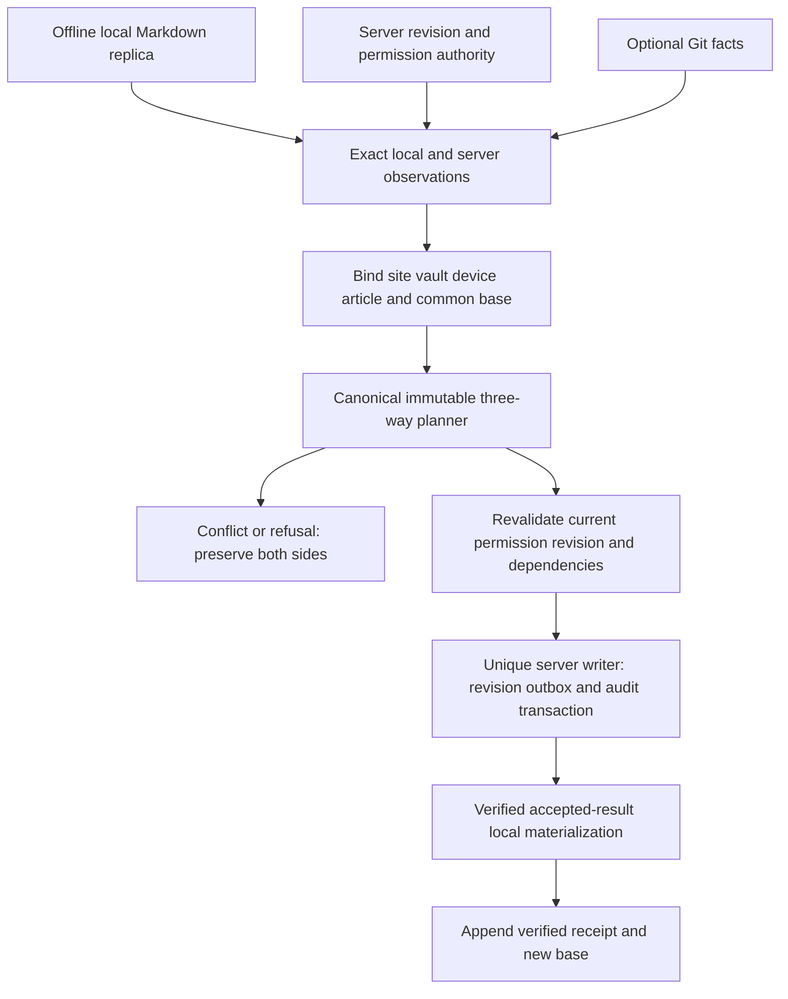

# Article Vault local-first decision record

This is NON-PRODUCTION decision evidence for
[#1871](https://github.com/Ozwasyd/FsusBlog/issues/1871), frozen against
`master@cb6f4e4a174ac65735707c7e44286352803e742b`. It records the already selected
architecture and a bounded prototype. It is not a new production authority or
security audit. The maintained [architecture](../../architecture.md) remains
owned by original #3582; its inspected decision increment is on
`codex/chain-3582-current-acceptance-20261008@a628ccb489c0a7d46468d590f9a336b6ed7b4ec8`.
The coordinator must register this supporting record through the existing
document lifecycle producer before integration.

## Decision and rejected alternatives

Choose only **C. bidirectional local-first vault**. A local Markdown directory
is an editable offline source replica. The server exclusively owns article
identity, revision, lifecycle, rights, publication, outbox, audit and public
delivery. All mutation directions bind a common base and consume #1909's one
planner/executor and canonical article writer.

The historical A/B alternatives are rejected, as recorded by the original
architecture owner: export-only workflows cannot represent continuous external
editing, common-base conflict or recovery after server acceptance; independent
directory saves introduce a second writer. The current issue does not name a
more specific A-versus-B labeling, so this record does not invent one. Neither
alternative appears as runnable code, configuration, UI mode or fallback.

## Data flow and authority

The console exercises only observations, bindings, plans and finite codecs in
memory. Writer, materialization and receipts in the diagram are downstream
responsibilities, not prototype implementations. A structurally valid synthetic
plan does not grant permission or qualify execution. Server acceptance must
precede new local base; local failure after acceptance remains a recovery
obligation. An all-or-nothing group cannot commit while a required dependency is
unresolved. #1865 package import, manual direction commands, Git and watchers
never supply independent fallback writers.

## Identity, path, asset and link matrix

| Concern | Authority and decision | Prototype evidence or remaining boundary |
| --- | --- | --- |
| Article identity | Site/Vault plus portable identity, server binding and operation identity | Rename retains exact identity; filename/title/slug/mtime are projections |
| Revision | Base server revision and sealed local/server source, metadata, dependency and permission digests | Current permission drift rejected; missing base yields no plan |
| Rename/move | Change path projection, preserve article and source coordinates | Canonical `NoOp`; no native rename execution |
| Local/server independent articles | Common base for each article, one canonical group | One `PushUpdate` and one `PullUpdate`, no writer invoked |
| Same-article concurrent edits | Three-way comparison, no mtime/length/last-write-wins | Both disjoint and overlapping source edits conservatively yield `both_modified`; #1911 owns resolution |
| Delete versus edit | Exact tombstone and current revision; explicit conflict, no filesystem inference | Descriptive boundary only; local missing file is not a deletion receipt |
| Asset identity/bytes | #1779 `AssetId`, content digest and ledger rights; path/URL not identity | AssetId parse/format plus synthetic byte preservation; portable mapping/upload absent on frozen master |
| Link and anchor | #1868 canonical target and FsusUI #289 grammar; route is projection | Existing builder/parser round-trip anchor; supplied target digest stable across slug change; portable rebinding absent |
| Embed | #1869 target, exact frozen publication revision and FsusUI #290 syntax | Existing target-token encode/decode only; no directive parser, provider or publication receipt |
| Metadata/YAML | Closed versioned editable metadata; no lifecycle/rights/owner/publication fields | Original canonical controls reject forbidden authority fields |
| Permissions | Current server observation, revalidated before group writes | Synthetic drift rejects the sealed plan; no real grant or server read |
| Recovery | Exact operation receipts/checkpoints; accepted server history retained | No prototype journal/base/receipt write; downstream obligations described below |

## Privacy and threat model

Private text and assets materialized to disk are actual plaintext exposure to
the OS account, local applications, backups, cloud folder tools, search indexes,
malware and physical/device access. No authorized encryption layer is implemented
here. OS disk encryption, when actually configured, is a separate control and
does not prevent an authorized editor or compromised session reading plaintext.
Do not promise natural local safety or blanket encryption.

Connect requires explicit scope and disclosure; fetch only authorized referenced
assets, never mirror the entire site. Agent trust must be limited to the chosen
root and finite IPC; no arbitrary shell/path/network service. Local filesystem
root containment, reparse/symlink policy and single writer lease belong to #1910.
This prototype executes no adversarial filesystem, root-lease or privilege probe.

Production diagnostics must avoid raw private source, tokens and sensitive
metadata. Backups and conflict copies require explicit byte budgets, TTL and
owned cleanup. Unlink stops synchronization without deleting either side;
deleting local copies is a separate explicit action. Logout/site switch revokes
the appropriate access and active agent participation through existing owners.
This task changes no credentials, grants or persistent access. Checked-in report
content is visibly synthetic and contains no real user data.

## Failure and recovery model

| Failure | Required state and recovery |
| --- | --- |
| Offline edit/reconnect | Retain local replica and base; re-observe server before planning; never flush a last-write-wins queue |
| Missing base, schema, identity or rights | Refuse before execution; reacquire exact canonical facts and build a new plan |
| Partial editor write or temp replacement | #1910 stable read obligation; incomplete bytes must not become accepted source |
| Case/Unicode ambiguity, unknown file identity | Refuse ambiguous mapping, preserving original files; no path/title guess |
| Watcher overflow or missing events | Bounded rescan obligation; absence of events cannot prove clean |
| Git conflict markers or interrupted operation | Block writer/publication until canonical admission resolves it; prototype exposes missing integration rather than inventing a parser |
| Stale plan or permission drift | Reject and re-plan; no reuse of the old expected revision |
| Server group fails | No business commit and no new local base; retain exact failed operation identity |
| Server accepts, local materialization fails | Recovery-required with accepted receipt; resume exact accepted result, never report synced |
| Crash before terminal result | Existing durable server ledger governs replay; local checkpoints govern materialization; no latest-file/mtime scan |
| Undo after accepted revision | Create a new canonical revision; never erase server history |
| Disk full or recovery quota reached | Refuse additional materialization, retain verified obligations and show capacity reason; no silent backup loss |

Ordinary server writing, saving, publishing and recovery remain available while
disconnected. The prototype's build graph and changed paths establish isolation;
actual server/product E2E evidence remains #1913. Unsupported/mobile environments
do not gain arbitrary filesystem sync through WebView or cloud-drive fallback.

## Governance and rollback

Production acceptance must reject path/title/mtime identity, two-way comparison,
direct watcher SQL/save-latest, YAML authority, multiple planners/writers,
package fallback, latest-target embeds and A/B runtime switches. This runner
links existing contracts and introduces no writer, merge implementation, target
codec or parser. Missing APIs are explicit refusals, not alternate ports.

The held kernel/root-lease concurrency, graph/occurrence admission, semantic
substitution, cross-container, cohort-pointer, template-integrity and Git
replacement-ref QA remain unexecuted. The scenario runner is ordinary synthetic
product evidence and cannot qualify those boundaries. Independent review and
criterion-by-criterion issue acceptance remain later steps. Rollback removes
the isolated prototype and supporting documents; production wiring is untouched.
