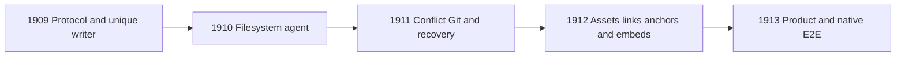

# Article Vault prototype evidence and limits

This NON-PRODUCTION source report supports the
[decision record](local-first-decision.md). The
[runner README](../../../prototypes/article-vault-1871/README.md) defines the
exact repository-root commands and report format. Only synthetic content and
in-memory canonical contracts are exercised. Native, writer and product
qualification are not implied.

## Source and ownership binding

The frozen source is `master@cb6f4e4a174ac65735707c7e44286352803e742b`.
The original #3582 owner explicitly confirmed no retained/unpublished prototype
source and transferred these isolated directories. It retains the current
architecture document and production/shared files. Initial local checkout
`aaba7b8c84ecfb336c71443e30d9fd82d21fb16d` was clean; all three reserved paths were
absent before branching. The inspected original branch tree at
`a628ccb489c0a7d46468d590f9a336b6ed7b4ec8` contained no candidate prototype paths.
This does not assert absence of unrelated unpublished files elsewhere.

The finite linked inputs are listed in
[canonical-sources.sha256.txt](../../../prototypes/article-vault-1871/canonical-sources.sha256.txt).
They include canonical manifest/planner contracts, anchor/link/target codecs,
AssetId, four original schemas and two original test classes. No source
algorithms are copied into the prototype. The original controls compile against
the same linked canonical implementation, not a supplier's claimed pass.

## Executed results

`bash prototypes/article-vault-1871/run.sh` completed all **10 scenario
assertions**, with zero failed assertions. Two consecutive final invocations
produced byte-identical JSON (`cmp` exit 0). The nested report SHA-256 is
`3da51821b0b7e80d1718cc8e1e27d5b238c981700708a94544082bbcfdc6f6c8`.
The whole checked-in JSON file SHA-256 is
`fede78dc8a05ff9892ec4154c17d9be7ff64e3ea490e06a405f5980518255d8e`.
The [generated binding](../../../prototypes/article-vault-1871/generated-output-binding.json)
records the source/output relationship; the report itself remains synthetic
decision evidence, not native, security or production qualification.

| Ordinary scenario | Actual canonical result |
| --- | --- |
| Path rename | Same portable identity and coordinates; `NoOp` |
| Independent articles, local/server edits | `Ready`, `PushUpdate` and `PullUpdate`; input reordering preserves plan bytes |
| Same article, disjoint edits | `Blocked`, `BothModified`, `both_modified`; no operation order |
| Same article, overlapping edits | `Blocked`, `BothModified`, `both_modified`; no automatic winner |
| Source/manifests | Original root/article/metadata codec bytes stable; BOM/CRLF/trailing spaces/final newline retained |
| Asset/link/anchor/target | Canonical finite ID/anchor/target codecs and synthetic bytes preserved; full portable dependency sync explicitly unavailable |
| Synthetic Git markers | Planner offers `PushUpdate`; execution explicitly unavailable without canonical admission |
| Current permission drift | `article_vault_plan_coordinate_drift` |
| Missing base | No plan; `article_vault_base_coordinate_missing` |
| Opt-out | No planner/watcher/writer invocation; production project and route isolation, without server E2E claim |

`bash prototypes/article-vault-1871/check-controls.sh` ran the two unchanged
original canonical test classes: **41 passed, 0 failed, 0 skipped**. The final
prototype build reports zero warnings/errors. Shell syntax, task C# style,
changed native/tooling/docs style, C# entrypoint ownership, authoritative
development-doc source classification and repository change-contract checks
passed. Production/shared source diffs are empty and no production source,
operations or workflow file references the prototype.

The lifecycle check remains blocked by the three new document paths requiring
explicit metadata and a regenerated inventory. The exact proposed records are
in [registration-proposal.json](registration-proposal.json); only the original
integration owner may apply them. Repository-wide code-intent checking also
fails on the unchanged
`src/frontend/wasm/aeds/include/font_theme_admin_pods.hpp:338` phrase
`no allocation`. This task does not weaken the check or edit that owner’s source.
No remote PR, aggregate, independent-review or merge gate is claimed passed.

The first prototype build had two argument-type errors at `ArticleBlockTarget.Create`;
the call sites were corrected to pass canonical `BlockAnchorId`, leaving the
original implementation unchanged. An initial standalone formatter invocation
could not write `/home/agent/.dotnet`; subsequent tool invocations used only the
task-owned `DOTNET_CLI_HOME`, as the runner now does. No permission or system
setting was changed. The first successful nine-scenario report remains in
ignored task scratch; the checked-in report is the final ten-scenario execution.

## Platform feasibility

| Platform or fixture | Actual evidence in this task | Qualification gap |
| --- | --- | --- |
| Managed C# contracts | Compile and synthetic execution with .NET 10.0.302 on this Linux host | No native agent/sync claim |
| Windows + NTFS | Original branch has Windows source and NTFS test files; not imported or run | Root/reparse/locking/atomic write/case-insensitive behavior unexercised |
| macOS + APFS | Original branch has FSEvents/native source and APFS test files; not imported or run | Actual APFS and Unicode/case behavior unexercised |
| Linux filesystem | Prototype uses memory; build/report files are ordinary task output | No ext4 watcher/stable-read/lease/materialization qualification |
| Case-sensitive/insensitive | Descriptive fixtures `draft.md` / `Draft.md` require ambiguity refusal by canonical path owner | No filesystem collision test run |
| Unicode | Descriptive composed/decomposed filename fixture requires canonical ambiguity handling | No normalization assumption or native pass |
| BOM/CRLF/LF | Canonical byte identity and round-trip assertions | No editor or native atomic-save claim |
| Git conflict | Literal synthetic marker bytes fed to planner; no Git process | Planner alone offers `PushUpdate`; missing canonical source-admission gate makes execution unavailable |

The namespaced link identity `article:<uuid>` is accepted by target contracts;
the root manifest currently derives a control filename from portable identity.
The prototype creates no such file. Native filename mapping, including the
Windows colon constraint, requires an actual accepted canonical mapping rather
than prototype sanitization.

The original #3582 branch has a `PortableDependencyCodec` source increment and
documents that package mapping/upload/materialization acceptance is still
missing. Those sources are absent from the frozen master used here. This task
does not transplant shared files or simulate accepted dependency facts. Full
asset/link round-trip must be rerun against the exact integrated finite API once
its canonical owner supplies it.

## Scale and resource estimates

These are arithmetic estimates, not benchmark measurements or accepted limits.
They match the original architecture owner's example: 10,000 articles at 256 KiB
each require reading 2.44 GiB of source for a full digest scan. At an assumed
100 MiB/s effective rate, byte I/O alone takes at least 25 seconds. A thousand
4 MiB assets add 3.91 GiB and at least 40 seconds. Enumeration, locks, hashing,
verification, retries and storage variation add time; repeated event/rescan
storms can multiply it. mtime cannot substitute for required digest validation.

Three retained 256 KiB versions consume 768 KiB per active article before copies,
syntax trees, manifests or runtime overhead; 32 active articles require at least
24 MiB of those bytes. With 10,000 small manifest entries assumed at 4 KiB,
inventory adds about 39 MiB before object overhead. These assumed sizes are
inputs to planning, not measured serializer sizes or an agent memory promise.

The agent must bound active articles, snapshot size, events/batches, queue and
watch counts, graph depth/nodes, asset transfer bytes, retries, rescan work and
backup/journal retention. Streaming scans and limited parallel work reduce peak
memory. Platform owners must measure latency distributions, memory and burst
recovery on native hosts before selecting budgets. This tiny console measures
no throughput, battery, watcher load or long-term recovery cost.

## Existing dependency and capability-owner map

This map preserves the original #3582 architecture's capability ownership;
tracking issues do not introduce additional production owners. GitHub #1909–#1913
currently have no assignee. Session-owner names are not inferred from that fact.

| Tracking node | Existing sole child capability owners |
| --- | --- |
| #1909 | #2103 manifest/state; #2104 planner; #2105 server executor; #2106 local materialization; #2107 receipts/lifecycle; #2108 governance |
| #1910 | #2109 path/classification; #2110 snapshot/write primitives; #2670/#2671/#2672 native observers; #2112 normalization/rescan; #2113 lease/IPC; #2114 lifecycle; #2673/#2674/#2675 qualification |
| #1911 | #2116 taxonomy; #2117 source merge; #2118 metadata; #2119 Git facts; #2120 resolution; #2121 journals; #2122 UI; #2123 controls |
| #1912 | #2124 manifests/plans; #2125 assets; #2126 anchors/links; #2127 frozen embeds; #2128 execution; #2129 round-trip/scale/permission controls |
| #1913 | #2130 connect/privacy/unlink; #2131 status; #2132 plan review; #2133 conflict/recovery; #2134 agent flows; #2135 publication/devices; #2676–#2679 and #2707–#2709 evidence, aggregated by #2136 |

Independent fixtures/docs can be prepared in parallel. Successors consume exact
implemented upstream APIs and cannot duplicate missing authority. This prototype
does not change issue bodies, production ownership, the DAG or any child status.
