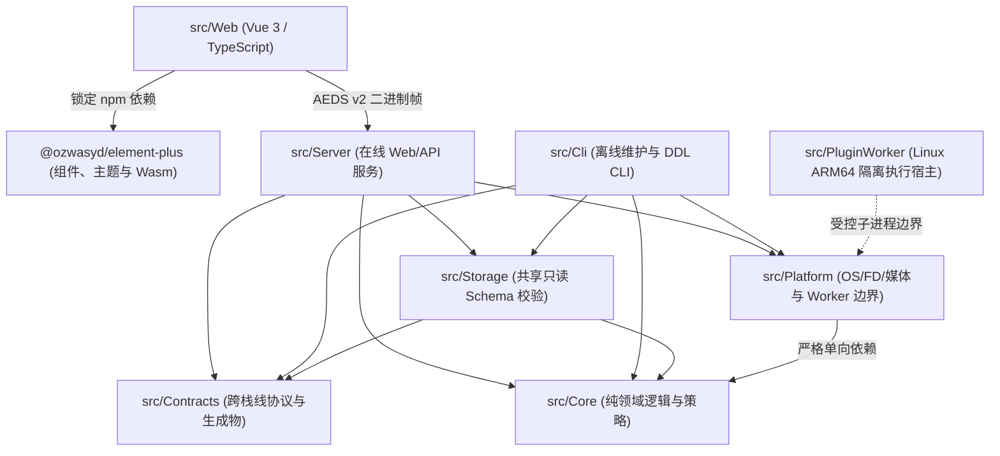
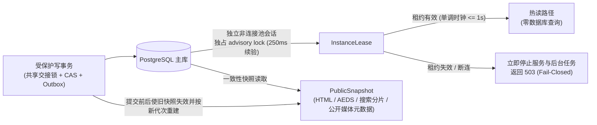

# 系统架构总览

> **角色**：架构说明
> **适用对象**：维护者、站点部署者与协议实现方
> **权威依据**：工程依赖以 [`FsusBlog.V2.slnx`](../../FsusBlog.V2.slnx) 与各 `.csproj` 为准；边界约束以 [`tests/Core/CorePlatformBoundaryGuardTests.cs`](../../tests/Core/CorePlatformBoundaryGuardTests.cs) 和 [`AGENTS.md`](../../AGENTS.md) 为准。

FsusBlog v2 是一个面向自托管与可验证部署的模块化单体内容系统：后端基于 .NET 10（C# 14、ASP.NET Core Minimal APIs）与 PostgreSQL 18（Npgsql），前端基于 Vue 3 + TypeScript 并消费 GitHub Packages 锁定的 `@ozwasyd/element-plus`（FsusUI）npm 包与内置原生 Wasm，跨栈业务通信统一采用 AEDS v2 二进制帧协议，数据初始化与高危离线维护集中在独立 CLI 工具 `FsusBlog.V2.Cli`。

---

## 1. 解决方案分层与依赖方向

| 工程 / 目录 | 职责边界 | 严禁越界的内容 |
| --- | --- | --- |
| `src/Contracts/` | AEDS v2 帧定义（`wire.schema.json`）、C#/TS/C++ 代码生成物与本地搜索编解码契约 | 手工修改生成文件（须经 `tools/protocol-generate.mjs` 生成） |
| `src/Core/` | 纯领域模型、状态机、加密/签名规范、验证策略 | 引入 HTTP、Cookie、Npgsql、文件系统或 OS 特定 API |
| `src/Platform/` | POSIX/PInvoke、目录句柄安全 I/O（密钥、媒体、扩展暂存、外观加载）、Linux Worker/cgroup 边界 | 反向被 `Core` 依赖（由 `CorePlatformBoundaryGuardTests` 静态守门） |
| `src/Storage/` | 共享 Schema 形态验证（`CurrentSchema`）与存储辅助，`internal` 仅向 `Server`/`Cli`/集成测试开放 | 包含建表 DDL 或在线自动改表逻辑 |
| `src/Server/` | 在线 HTTP/AEDS 端点、只读启动准入、公开快照与单机租约、身份与权限执行 | 自动执行 DDL 或通过 HTTP 暴露 break-glass 维护能力 |
| `src/Cli/` | 离线初始化（`plan`/`apply`/`verify`）、密钥生成、管理员引导、备份指纹、媒体重建、每日检查点签发 | 混入在线 HTTP 请求处理 |
| `src/PluginWorker/` | Linux ARM64 专用离线签名纯 Markdown 插件隔离进程与 C 启动器 | 绕过签名核验、无沙箱执行或访问生产凭据 |
| `src/Web/` | 公开阅读界面、客户端搜索 Worker、作者工作区、Canvas 与管理控制台 | 绕过本地源码 alias 切换至 npm 包或覆盖 FsusUI 私有样式 |

---

## 2. 在线服务与离线 CLI 隔离

FsusBlog v2 严格拆分**在线数据面**与**离线控制面**：

- **建表 SQL 仅嵌入 `src/Cli/Schema/01..04*.sql`**：新建空库通过 `FsusBlog.V2.Cli` 执行 `plan` → `apply` → `verify` 原子初始化。
- **在线服务假设数据库账号仅有 DML 权限**：`FsusBlog.V2.Server` 启动时调用共享程序集 `FsusBlog.V2.Storage.dll` 的 `CurrentSchema.VerifyAsync` 只读核验版本标记、表结构、列与约束；遇到缺失、漂移或未初始化库时立即 fail-closed 退出，绝不自动执行 DDL。
- **高危与离线维护全部收口在 CLI**：包括 `init-secrets`、`admin-identity bootstrap/rotate-passkey/revoke-all/disable`、`backup measure`、`article-public-media rebuild`、`publication-transparency checkpoint-*` 等。详情见 [PostgreSQL 离线维护与备份恢复](../migration.md)。

---

## 3. 单机租约、公开快照与读取一致性

- **单机独占准入**：同一 PostgreSQL 主库上同时仅允许一个服务进程持有独占 advisory lock 并对外就绪；备用进程交接需经过排他交接锁与读期限排空，防止双写与旧代次复活。
- **同一公开代次（Generation）**：文章详情 HTML、AEDS 列表/详情、RSS/Atom/JSON Feed、公开图片清单以及浏览器搜索分片均派生自同一个不可变 `PublicSnapshot` 代次；文章撤回或归档后旧代次请求返回 `409` 或 `404`，避免部分路径泄露已撤回内容。详情见 [单机数据库租约与交接](../publication-lease.md)。

---

## 4. AEDS v2 跨栈二进制协议

- 所有运行时业务接口均采用 `application/octet-stream` 承载 AEDS v2 二进制帧（16 字节小端标头 + 帧类型 + 长度 + CRC-16），不提供 JSON 业务回退（`GET /integrity/keys.json`、`GET /manifest.webmanifest`、Feed/Sitemap 等标准公开文档除外）。
- 协议单一事实来源为 [`src/Contracts/wire.schema.json`](../../src/Contracts/wire.schema.json)，由 [`tools/protocol-generate.mjs`](../../tools/protocol-generate.mjs) 同步生成 C#、TypeScript 与 C++ 构件，并通过 `./tools/protocol-test.sh` 执行跨语言向量与 Wasm 差分校验。详情见 [AEDS v2 二进制协议](../protocol.md)。

---

## 5. 身份隔离与纵深安全架构

FsusBlog v2 默认采用**统一单域名 HTTPS 部署**（也可按需显式拆分独立管理域名或关闭全部后台路由），安全边界由多层独立约束共同保证：

| 防护层 | 核心机制 |
| --- | --- |
| 角色与表隔离 | 系统仅保留普通读者 `User`（`blog_user` / `passkey_credential` / `fsus-v2-session`）与统一管理员 `Admin`（`admin_principal` / `admin_passkey_credential` / `__Host-FsusAdminSession`），会话端点（`/api/v2/identity/session.aeds` vs `/api/v2/admin/identity/session.aeds` & `/api/v2/authoring/session.aeds`）完全分离 |
| 统一入口与同源防护 | `/login` 按 Passkey 归属表自动分流；全站统一输出严格 `Content-Security-Policy`、`X-Content-Type-Options: nosniff`、`Referrer-Policy: same-origin` 与 `SameSite=Strict` + `HttpOnly` Cookie；安全 Markdown 渲染禁用原始 HTML 与不安全协议 |
| 写操作防重放与二次验证 | 高危管理变更强制 45 秒一次性 Passkey Step-Up、作用域绑定 PoW、乐观并发 CAS、幂等键与 `X-Fsus-Admin-Permission-Session` 防串响应校验 |
| 反代单跳信任边界 | `FSUSBLOG_TRUST_LOOPBACK_PROXY=true` 仅信任本机回环单跳转发头，拒绝客户端伪造头或多跳 `X-Forwarded-For`（fail-closed 返回 400） |
| 能力统一解析 | 启动期由 [`SiteCapabilities`](../../src/Server/Operations/SiteCapabilities.cs) 统一求值所有成熟能力的默认激活与显式关闭（`FSUSBLOG_*=false` 或空字符串），关闭后不挂载对应路由。详见 [站点能力默认开启与静默覆盖](../product/site-capabilities.md) |

---

## 6. 全文检索与内容完整性子系统

- **公开搜索三模式（`FSUSBLOG_PUBLIC_SEARCH_MODE`）**：
  - `server`（默认，#49）：直连零数据库查询的服务端 `/api/v2/public/search.aeds`（AEDS `33081`），零搜索 Worker、零全量语料下载、零搜索 IndexedDB 写入，不依赖客户端存储或 Web Locks；
  - `auto`（显式 opt-in）：中小语料由浏览器 Worker 下载 FSPK v4 分片并在同源 IndexedDB 缓存复用（支持 ETag 304 与 FSPT 增量补丁）；超出紧凑档预算时按配置切至宽语料分片，或回落至服务端检索；
  - `local`（显式 opt-in）：严格走客户端分片检索（每次展示仍需经网络 `HEAD` 校验当前公开代次，非离线能力）。
  - 详情见 [本地全文检索](../product/public-search.md) 与 [公开 FAS4 服务端检索](../product/fas4-search.md)。
- **可验证发布与完整性**：支持发布规范摘要、ECDSA P-256 签名与公开密钥清单（`/integrity/keys.json`）、发布透明日志头以及由独立只读账户与专用签名密钥驱动的每日 Merkle 检查点归档。详情见 [公开验证密钥](../product/integrity-keys.md) 与 [发布权利快照](../product/publication-rights.md)。
